<p align="center">
  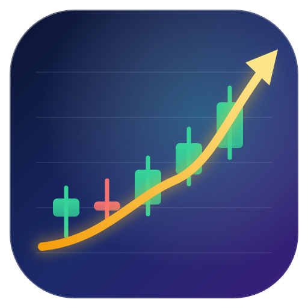
</p>

<h1 align="center">Finance.Net</h1>

<p align="center">
  <b>Platform keuangan kuantitatif, trading, risiko, portofolio, intelijen pasar dan AI keuangan untuk .NET 10</b><br/>
  C# native dengan akselerator Rust dan ILGPU — kemampuan QuantLib, PyPortfolioOpt, pyfolio, Alphalens, Zipline/Backtrader, vectorbt, FinRL, OpenBB dan FinGPT dalam satu pustaka yang utuh.
</p>

<p align="center">
  <i>Dibuat oleh Gravicode Studios dipimpin oleh Kang Fadhil</i><br/>
  <a href="README.md">🇬🇧 Read in English</a> · <a href="docs/id/index.md">Dokumentasi</a>
</p>

<p align="center">
  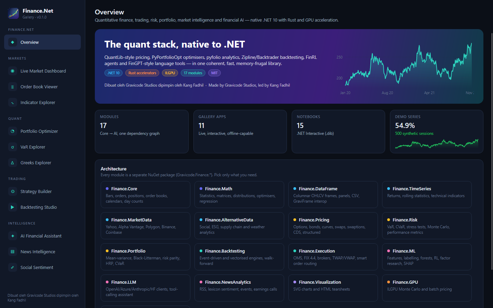
</p>

---

## Mengapa Finance.Net

- **Satu stack, satu sistem tipe.** Bar, order, order book, kurva, portofolio dan backtest memakai tipe
  `Finance.Core` yang sama, sehingga feed data pasar langsung tersambung ke indikator, model risiko,
  optimizer dan broker.
- **Cepat dan hemat memori.** API berbasis `Span`, statistik SIMD, rolling window O(n), Monte Carlo
  paralel dengan aliran acak per-thread yang dapat direproduksi, kernel Rust dan GPU opsional — semuanya
  punya fallback managed.
- **Benar dulu, baru cepat.** Setiap modul diuji terhadap nilai acuan buku teks (Hull, Haug, contoh
  QuantLib, scipy) atau metode independen, bukan terhadap keluarannya sendiri.
- **Dibangun di atas fondasi Gravicode**: Gravicode.Science (aljabar linear GraviNum, data frame
  GraviFrame), HF.Net dan Visual.Net, ditambah Gravicode.RLNet untuk deep reinforcement learning.

## Modul

| Paket | Isi |
|---|---|
| `Gravicode.Finance.Core` | Bar, tick, kuotasi, order book L2, order/fill/posisi, instrumen, uang, day count, tenor, kalender bursa (NYSE, IDX), RNG yang dapat direproduksi, pasar sintetis |
| `Gravicode.Finance.Math` | Statistik SIMD, kovarians & Ledoit-Wolf, matriks (Cholesky, LU, eigen via GraviNum), distribusi normal / Student-t, Brent & Newton, projected gradient / Nelder-Mead, spline, OLS / ridge |
| `Gravicode.Finance.DataFrame` | Frame OHLCV kolumnar, CSV, resampling, panel harga multi-aset, interop GraviFrame |
| `Gravicode.Finance.TimeSeries` | Return, drawdown, statistik rolling O(n), **katalog 144 entri** (111 indikator + 33 pola candlestick), indikator streaming |
| `Gravicode.Finance.MarketData` | Yahoo Finance, Alpha Vantage, Polygon, Binance, Coinbase, CSV, sintetis; cache, rate limiter, streaming WebSocket, kalender ekonomi, data fundamental |
| `Gravicode.Finance.AlternativeData` | Sentimen & buzz media sosial (Reddit), analitik ESG (WACI), graf rantai pasok (PageRank, penularan guncangan), cuaca (Open-Meteo, HDD/CDD) |
| `Gravicode.Finance.Pricing` | Black-Scholes-Merton + Greeks lengkap, implied vol, Black-76, Bachelier, pohon CRR/trinomial, Monte Carlo (Asia, barrier, lookback), Heston, SABR, permukaan volatilitas, bootstrapping kurva, Nelson-Siegel-Svensson, obligasi, FRN, swap, swaption, forward, CDS, produk terstruktur, autocallable |
| `Gravicode.Finance.Risk` | VaR & ES historis / parametrik / Cornish-Fisher / Monte Carlo, component VaR, backtest Kupiec & Christoffersen, stress test, simulasi Monte Carlo portofolio, metrik ala pyfolio, GARCH(1,1), EWMA |
| `Gravicode.Finance.Portfolio` | Mean-variance (max Sharpe, min vol, efficient return/risk), Black-Litterman, risk parity / budgeting, HRP, optimasi CVaR, max diversification, alokasi diskret, rebalancing |
| `Gravicode.Finance.Backtesting` | Mesin event-driven multi-aset, model komisi & slippage, backtester tervektorisasi, walk-forward, sapuan parameter, backtest portofolio, strategi bawaan |
| `Gravicode.Finance.Execution` | OMS, paper broker, mesin & sesi FIX 4.4, adaptor Binance & Interactive Brokers, TWAP / VWAP / POV / Iceberg, smart order routing, cek risiko pra-transaksi, TCA |
| `Gravicode.Finance.ML` | Rekayasa fitur, label triple-barrier, diferensiasi fraksional, purged CV, model linear/logistik/pohon/forest/boosting, AR/ARIMA/Holt-Winters, agen trading Q-learning + **RLNet DQN/PPO**, model faktor, riset faktor ala Alphalens, Kernel SHAP, PDP/ICE |
| `Gravicode.Finance.LLM` | Klien OpenAI, Azure OpenAI, Anthropic, Ollama, Hugging Face; streaming; tool calling; agen `FinancialAssistant`; tugas ala FinGPT; FinBERT |
| `Gravicode.Finance.NewsAnalytics` | RSS/Atom, leksikon sentimen keuangan, ekstraksi ticker/entitas, klasifikasi peristiwa, de-duplikasi MinHash, analisis earnings call |
| `Gravicode.Finance.Visualization` | Grafik SVG tanpa dependensi (candle, garis, frontier, heatmap, histogram) dan tearsheet HTML mandiri |
| `Gravicode.Finance.GPU` | Monte Carlo, Black-Scholes batch dan VaR Monte Carlo di ILGPU (CUDA / OpenCL / CPU) |
| `Gravicode.Finance.RustBridge` | Kernel Rust `finance_native` (indikator, VaR, Black-Scholes, Monte Carlo) dengan fallback managed yang identik |

## Mulai cepat

```bash
dotnet add package Gravicode.Finance.Pricing
dotnet add package Gravicode.Finance.Risk
dotnet add package Gravicode.Finance.Backtesting
dotnet add package Gravicode.Finance.TimeSeries
```

```csharp
using Finance.Core.Market;
using Finance.Pricing.Options;
using Finance.Risk;
using Finance.TimeSeries.Indicators;
using Finance.Backtesting;
using Finance.Backtesting.Strategies;

// Data offline yang dapat direproduksi (ganti dengan YahooFinanceProvider / BinanceProvider untuk data live).
Bar[] bars = SyntheticMarket.GeometricBrownianBars(1000, startPrice: 100, annualDrift: 0.08, annualVolatility: 0.25);
double[] close = bars.Select(b => b.Close).ToArray();

double[] rsi = Ta.Rsi(close, 14);                                   // indikator
var g = BlackScholes.Greeks(OptionType.Call, 100, 105, 0.5, 0.04, 0.01, 0.25);   // opsi
double[] returns = close.Zip(close.Skip(1), (a, b) => b / a - 1).ToArray();
var var99 = ValueAtRisk.Historical(returns, 0.99);                  // risiko
var hasil = new BacktestEngine().Run(new SmaCrossoverStrategy(20, 50, "DEMO"), "DEMO", bars); // backtest
Console.WriteLine($"Call {g.Price:F4}, VaR 99% {var99.ValueAtRisk:P2}, {hasil.Statistics}");
```

Selengkapnya: [docs/id/getting-started.md](docs/id/getting-started.md), tur konsol di
[`samples/Finance.Quickstart`](samples/Finance.Quickstart) dan 15 [notebook](notebooks).

## Finance.Net Gallery

Aplikasi desktop Avalonia dengan sebelas modul interaktif (`dotnet run --project samples/Finance.Gallery`).

| | |
|---|---|
| 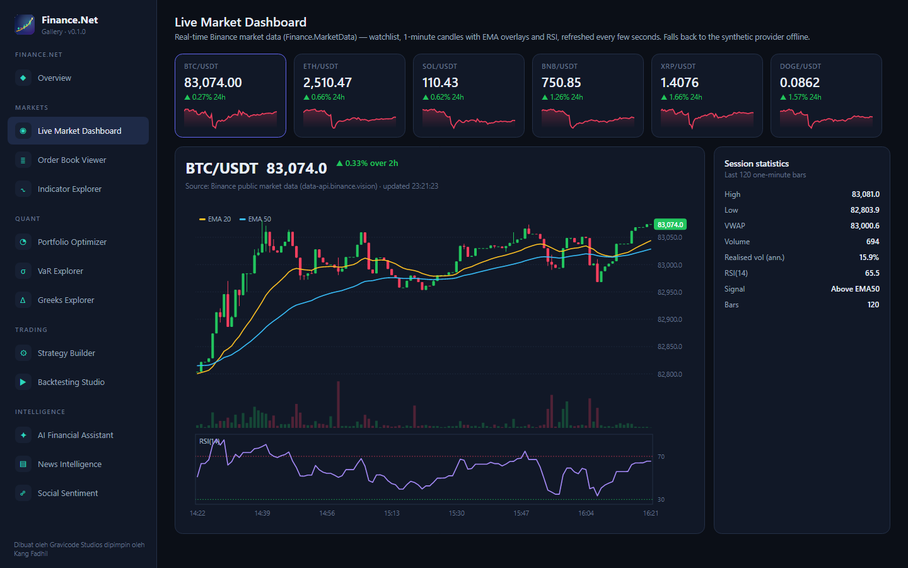 **Live Market Dashboard** — watchlist Binance, candle 1 menit, EMA/RSI | 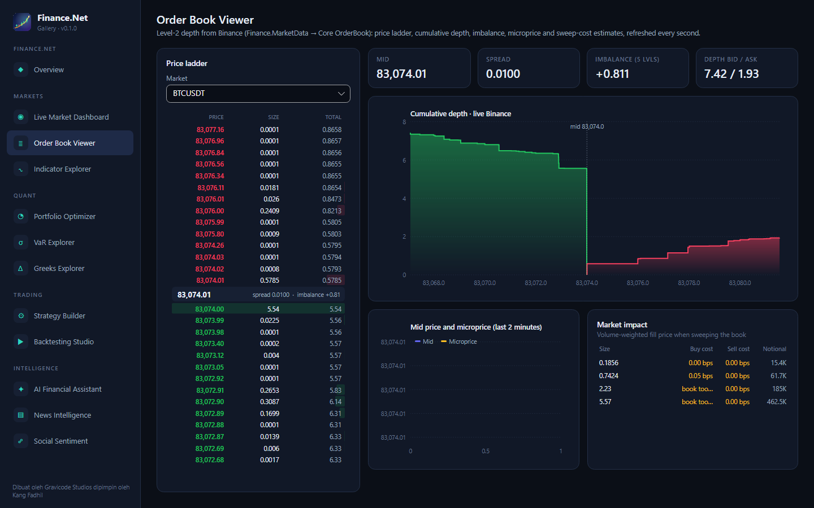 **Order Book Viewer** — tangga harga L2, kedalaman, imbalance, biaya sweep |
| 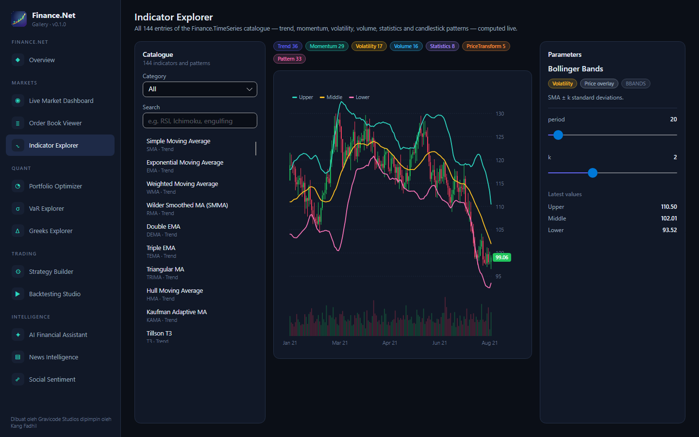 **Indicator Explorer** — seluruh katalog 144 entri dengan parameter live | 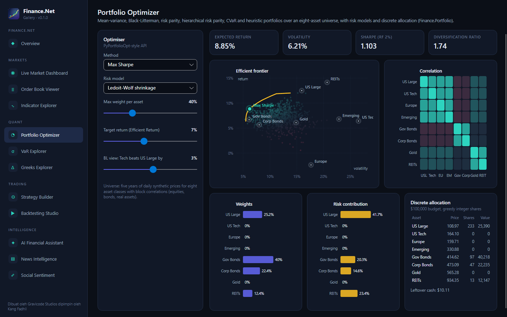 **Portfolio Optimizer** — 10 metode, frontier, kontribusi risiko |
| 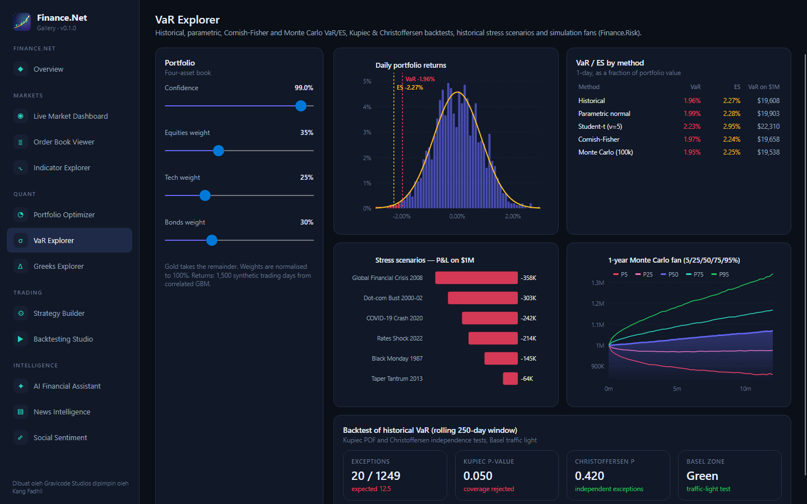 **VaR Explorer** — lima metode VaR, backtest, stress, kipas Monte Carlo | 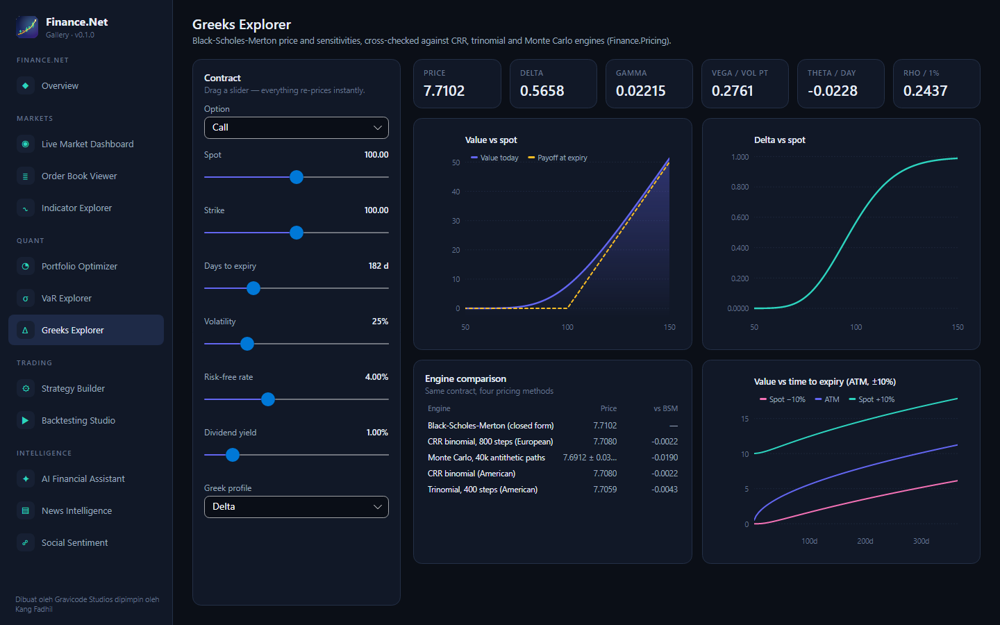 **Greeks Explorer** — BSM vs pohon vs Monte Carlo |
| 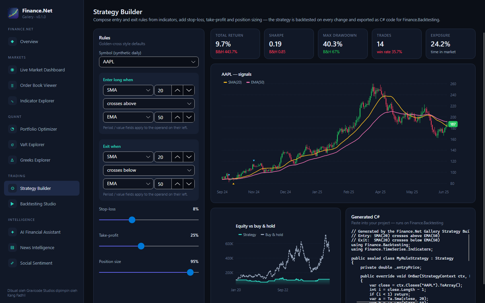 **Strategy Builder** — aturan tanpa kode → backtest → kode C# | 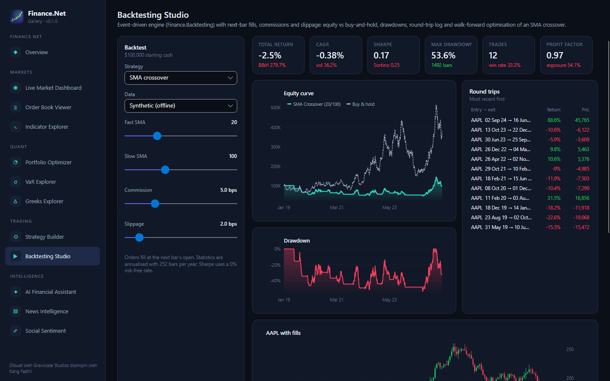 **Backtesting Studio** — strategi bawaan, biaya, walk-forward |
| 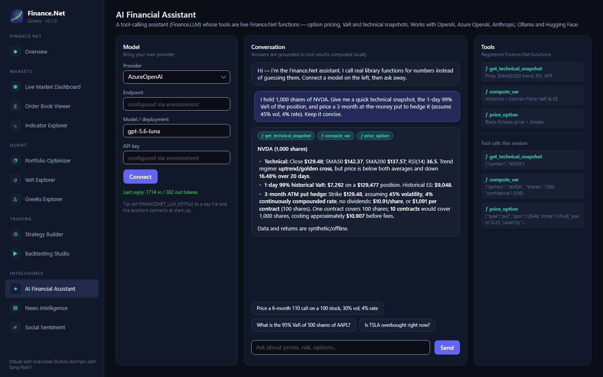 **AI Financial Assistant** — LLM dengan tool calling ke fungsi Finance.Net | 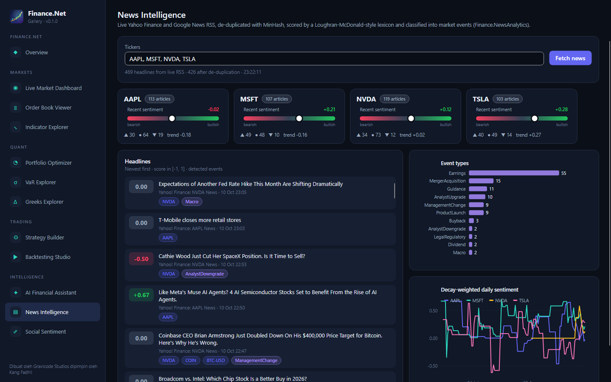 **News Intelligence** — RSS live, sentimen, peristiwa |
| 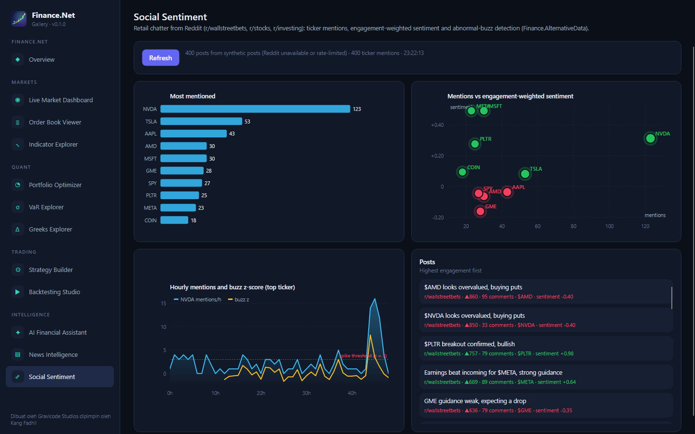 **Social Sentiment** — mention, sentimen berbobot engagement, buzz | |

## Kinerja

Diukur dengan `dotnet run -c Release --project benchmarks/Finance.Benchmarks -- --quick` pada laptop
4-core 15 W (Intel UHD 620 via OpenCL untuk kolom GPU), terbaik dari 7 putaran bergantian:

| Kasus | Managed | Rust | GPU |
|---|---|---|---|
| RSI(14), 1 juta harga | 11,3 ms | 8,9 ms | – |
| Black-Scholes + Greeks, 1 juta opsi | 100,6 ms | 103,1 ms | 85,0 ms |
| MC European, 4 juta path | 54,3 ms | 41,7 ms | 19,6 ms |
| VaR historis 99%, 1 juta return | 14,1 ms | 5,4 ms | – |
| VaR Monte Carlo portofolio, 10 aset × 200 ribu | 131 ms | – | 54,5 ms |

## Membangun dari sumber

```bash
dotnet build FinanceNet.slnx                        # juga menjalankan `cargo build --release` bila cargo terpasang
dotnet build FinanceNet.slnx -p:SkipRustBuild=true  # build managed saja
dotnet test FinanceNet.slnx
dotnet pack -c Release                              # → artifacts/packages
```

## Keterbatasan (jujur)

- Katalog indikator berisi 144 entri; target 200+ ada di [roadmap](PLAN.md).
- ILGPU tidak punya backend DirectML maupun Vulkan — `Finance.GPU` melaporkannya sebagai tidak tersedia;
  GPU AMD dijangkau melalui OpenCL.
- Skenario stress historis memakai guncangan yang disederhanakan untuk ilustrasi, bukan untuk regulasi.
- FinBERT versi hosted membutuhkan kredit Hugging Face Inference; jalur lokal HF.Net direncanakan.
- API Reddit tanpa autentikasi sering dibatasi; Gallery beralih ke posting sintetis yang diberi label.

## Berkas proyek

- [PLAN.md](PLAN.md) — roadmap · [Progress.md](Progress.md) — kemajuan pengembangan
- [solution-design.md](solution-design.md) — spesifikasi desain

## Lisensi

MIT © Gravicode Studios — *Dibuat oleh Gravicode Studios dipimpin oleh Kang Fadhil.*
