# Finance.Net Documentation

> **Made by Gravicode Studios, led by Kang Fadhil**
>
> [Bahasa Indonesia](../id/index.md)

Finance.Net is a quantitative-finance platform for **.NET 10**. It brings the capabilities of the
Python finance ecosystem into one native, strongly typed library: QuantLib-style pricing,
PyPortfolioOpt portfolio construction, pyfolio performance analytics, Alphalens factor research,
Zipline/Backtrader backtesting, FinRL reinforcement learning and FinGPT-style language tools. Hot
paths can run on **Rust** kernels (`Finance.RustBridge`) or on the **GPU** (`Finance.GPU`, ILGPU).

It is built on the author's own foundation libraries:
**Gravicode.Science** (GraviNum for linear algebra and GraviFrame for data frames), **HF.Net**,
**Visual.Net** and **Gravicode.RLNet** (deep reinforcement learning).

## Contents

| Guide | What it covers |
|---|---|
| [Getting started](getting-started.md) | Install, first program, building from source, tests, apps, configuration |
| [Gallery](gallery.md) | The Avalonia desktop app and its 12 pages |
| [Notebooks](notebooks.md) | The 15 .NET Interactive notebooks |
| [Benchmarks](benchmarks.md) | Measured managed vs Rust vs GPU timings |

### Module guides

| Layer | Modules |
|---|---|
| Foundation | [Core](modules/core.md) · [Math](modules/math.md) · [DataFrame](modules/dataframe.md) · [TimeSeries](modules/timeseries.md) |
| Data | [MarketData](modules/marketdata.md) · [AlternativeData](modules/alternativedata.md) |
| Quant | [Pricing](modules/pricing.md) · [Risk](modules/risk.md) · [Portfolio](modules/portfolio.md) |
| Trading | [Backtesting](modules/backtesting.md) · [Execution](modules/execution.md) |
| AI | [ML](modules/ml.md) · [LLM](modules/llm.md) · [NewsAnalytics](modules/newsanalytics.md) |
| Output & acceleration | [Visualization](modules/visualization.md) · [GPU](modules/gpu.md) · [RustBridge](modules/rustbridge.md) |

## Architecture

```mermaid
flowchart TB
    subgraph Foundation
        Core[Finance.Core<br/>bars, orders, calendars, RNG]
        Math[Finance.Math<br/>stats, matrices, optimisers]
        DF[Finance.DataFrame<br/>OHLCV frames, panels]
        TS[Finance.TimeSeries<br/>returns, rolling, 144 indicators]
    end
    subgraph Data
        MD[Finance.MarketData<br/>Yahoo, Binance, Coinbase, AV, Polygon]
        AD[Finance.AlternativeData<br/>social, ESG, supply chain, weather]
    end
    subgraph Quant
        PR[Finance.Pricing<br/>options, rates, credit, structured]
        RK[Finance.Risk<br/>VaR/ES, stress, simulation, metrics]
        PF[Finance.Portfolio<br/>MVO, BL, risk parity, HRP, CVaR]
    end
    subgraph Trading
        BT[Finance.Backtesting<br/>event-driven, vectorised, walk-forward]
        EX[Finance.Execution<br/>OMS, FIX 4.4, brokers, algos, SOR]
    end
    subgraph AI
        ML[Finance.ML<br/>models, labels, RL, factors, SHAP]
        LLM[Finance.LLM<br/>chat clients, tool-calling assistant]
        NA[Finance.NewsAnalytics<br/>RSS, sentiment, events]
    end
    subgraph Acceleration
        GPU[Finance.GPU<br/>ILGPU kernels]
        RB[Finance.RustBridge<br/>Rust kernels + managed fallback]
    end
    VIS[Finance.Visualization<br/>SVG charts, HTML tearsheets]

    Core --> Math --> DF --> TS
    Core --> MD
    Math --> AD & PR & RK & PF & BT & ML & NA & VIS & GPU
    Core --> EX & LLM & RB
    GraviNum[(Gravicode.Science.GraviNum)] -.-> Math
    GraviFrame[(Gravicode.Science.GraviFrame)] -.-> DF
    RLNet[(Gravicode.RLNet)] -.-> ML
    ILGPU[(ILGPU)] -.-> GPU
    Rust[(native/finance-native<br/>Rust cdylib)] -.-> RB
```



Every module is an independent project with a minimal dependency set. `Finance.Core` and
`Finance.Math` are the only modules almost everything else references; domain modules do not
depend on each other, so you install only what you use.

## Packages

All packages target `net10.0`. NuGet IDs follow the pattern `Gravicode.<ProjectName>`.

| Package | Purpose |
|---|---|
| `Gravicode.Finance.Core` | Bars, ticks, quotes, orders, fills, positions, order books, calendars, day counts, deterministic RNG, synthetic markets |
| `Gravicode.Finance.Math` | SIMD statistics, dense matrices (GraviNum interop), normal/Student-t distributions, root finding, optimisers, interpolation, regression |
| `Gravicode.Finance.DataFrame` | Columnar OHLCV frames, aligned price panels, CSV, GraviFrame interop |
| `Gravicode.Finance.TimeSeries` | Returns, drawdowns, O(n) rolling statistics, 144-entry indicator catalogue, streaming indicators |
| `Gravicode.Finance.MarketData` | Yahoo Finance, Alpha Vantage, Polygon, Binance, Coinbase, CSV and synthetic providers; streaming; economic and fundamental data |
| `Gravicode.Finance.AlternativeData` | Social-media sentiment, ESG analytics, supply-chain graphs, weather analytics |
| `Gravicode.Finance.Pricing` | Black-Scholes, Black-76, Bachelier, trees, Monte Carlo, Heston, SABR, curves, bonds, swaps, swaptions, CDS, structured notes |
| `Gravicode.Finance.Risk` | VaR/ES (historical, parametric, Cornish-Fisher, Monte Carlo), backtests, stress tests, simulation, performance metrics, GARCH |
| `Gravicode.Finance.Portfolio` | Mean-variance, Black-Litterman, risk parity, HRP, CVaR, discrete allocation |
| `Gravicode.Finance.Backtesting` | Event-driven engine, vectorised backtester, walk-forward optimisation, portfolio rebalancing |
| `Gravicode.Finance.Execution` | OMS, paper/Binance/Interactive Brokers brokers, FIX 4.4, TWAP/VWAP/POV/Iceberg, smart order routing, TCA |
| `Gravicode.Finance.ML` | Trees, forests, boosting, linear models, labelling, purged CV, forecasting, RL (incl. RLNet), factor research, SHAP |
| `Gravicode.Finance.LLM` | OpenAI, Azure OpenAI, Anthropic, Ollama and Hugging Face clients; tool-calling assistant; FinBERT |
| `Gravicode.Finance.NewsAnalytics` | RSS reader, finance lexicon sentiment, entity and event extraction, MinHash de-duplication, earnings calls |
| `Gravicode.Finance.Visualization` | Dependency-free SVG charts and self-contained HTML tearsheets |
| `Gravicode.Finance.GPU` | ILGPU Monte Carlo pricing, batch Black-Scholes, Monte Carlo VaR |
| `Gravicode.Finance.RustBridge` | Rust kernels (indicators, VaR, pricing, Monte Carlo) with an identical managed fallback |

## Install

```bash
dotnet add package Gravicode.Finance.Pricing
dotnet add package Gravicode.Finance.Risk
dotnet add package Gravicode.Finance.Portfolio
```

Each package pulls in its dependencies automatically (`Gravicode.Finance.Core` always, and
`Gravicode.Finance.Math` for every numerical module). See
[Getting started](getting-started.md) for a first program and for building from source.

## Design principles

- **Correct first.** Tests check results against textbook values (Hull, Haug), closed forms,
  independent methods (Monte Carlo vs analytic, lattice convergence) or naive reference
  implementations — never against the implementation's own output.
- **Fast and frugal.** `Span<T>`, SIMD (`Vector<T>`), O(n) rolling algorithms and parallel Monte
  Carlo with reproducible per-thread random streams.
- **Offline by default.** Every sample, test and Gallery page runs on deterministic synthetic data
  (`SyntheticMarket`, `SyntheticProvider`) when the network is unavailable.
- **Honest limits.** Each module guide ends with a *Notes and limitations* section.

---

Made by Gravicode Studios, led by Kang Fadhil · Dibuat oleh Gravicode Studios dipimpin oleh Kang Fadhil
