# Dokumentasi Finance.Net

> **Dibuat oleh Gravicode Studios dipimpin oleh Kang Fadhil**
>
> [English](../en/index.md)

Finance.Net adalah platform keuangan kuantitatif untuk **.NET 10**. Library ini menghadirkan
kemampuan ekosistem keuangan Python ke dalam satu library native yang bertipe kuat: penilaian
derivatif ala QuantLib, konstruksi portofolio ala PyPortfolioOpt, analitik kinerja ala pyfolio,
riset faktor ala Alphalens, backtesting ala Zipline/Backtrader, reinforcement learning ala FinRL,
dan alat bahasa ala FinGPT. Bagian yang paling berat komputasinya bisa dijalankan di kernel
**Rust** (`Finance.RustBridge`) atau di **GPU** (`Finance.GPU`, ILGPU).

Fondasinya adalah library milik penulis sendiri:
**Gravicode.Science** (GraviNum untuk aljabar linear dan GraviFrame untuk data frame), **HF.Net**,
**Visual.Net**, dan **Gravicode.RLNet** (deep reinforcement learning).

## Daftar isi

| Panduan | Isi |
|---|---|
| [Memulai](getting-started.md) | Instalasi, program pertama, build dari source, pengujian, aplikasi, konfigurasi |
| [Gallery](gallery.md) | Aplikasi desktop Avalonia dan 12 halamannya |
| [Notebook](notebooks.md) | 15 notebook .NET Interactive |
| [Benchmark](benchmarks.md) | Hasil pengukuran managed vs Rust vs GPU |

### Panduan per modul

| Lapisan | Modul |
|---|---|
| Fondasi | [Core](modules/core.md) · [Math](modules/math.md) · [DataFrame](modules/dataframe.md) · [TimeSeries](modules/timeseries.md) |
| Data | [MarketData](modules/marketdata.md) · [AlternativeData](modules/alternativedata.md) |
| Kuantitatif | [Pricing](modules/pricing.md) · [Risk](modules/risk.md) · [Portfolio](modules/portfolio.md) |
| Trading | [Backtesting](modules/backtesting.md) · [Execution](modules/execution.md) |
| AI | [ML](modules/ml.md) · [LLM](modules/llm.md) · [NewsAnalytics](modules/newsanalytics.md) |
| Keluaran & akselerasi | [Visualization](modules/visualization.md) · [GPU](modules/gpu.md) · [RustBridge](modules/rustbridge.md) |

## Arsitektur

```mermaid
flowchart TB
    subgraph Fondasi
        Core[Finance.Core<br/>bar, order, kalender, RNG]
        Math[Finance.Math<br/>statistik, matriks, optimizer]
        DF[Finance.DataFrame<br/>frame OHLCV, panel]
        TS[Finance.TimeSeries<br/>return, rolling, 248 indikator]
    end
    subgraph Data
        MD[Finance.MarketData<br/>Yahoo, Binance, Coinbase, AV, Polygon]
        AD[Finance.AlternativeData<br/>sosial, ESG, rantai pasok, cuaca]
    end
    subgraph Kuantitatif
        PR[Finance.Pricing<br/>opsi, suku bunga, kredit, terstruktur]
        RK[Finance.Risk<br/>VaR/ES, stress, simulasi, metrik]
        PF[Finance.Portfolio<br/>MVO, BL, risk parity, HRP, CVaR]
    end
    subgraph Trading
        BT[Finance.Backtesting<br/>event-driven, vektor, walk-forward]
        EX[Finance.Execution<br/>OMS, FIX 4.4, broker, algo, SOR]
    end
    subgraph AI
        ML[Finance.ML<br/>model, label, RL, faktor, SHAP]
        LLM[Finance.LLM<br/>klien chat, asisten tool-calling]
        NA[Finance.NewsAnalytics<br/>RSS, sentimen, event]
    end
    subgraph Akselerasi
        GPU[Finance.GPU<br/>kernel ILGPU]
        RB[Finance.RustBridge<br/>kernel Rust + fallback managed]
    end
    VIS[Finance.Visualization<br/>grafik SVG, tearsheet HTML]

    Core --> Math --> DF --> TS
    Core --> MD
    Math --> AD & PR & RK & PF & BT & ML & NA & VIS & GPU
    Core --> EX & LLM & RB
    GraviNum[(Gravicode.Science.GraviNum)] -.-> Math
    GraviFrame[(Gravicode.Science.GraviFrame)] -.-> DF
    RLNet[(Gravicode.RLNet)] -.-> ML
    ILGPU[(ILGPU)] -.-> GPU
    Rust[(native/finance-native<br/>cdylib Rust)] -.-> RB
```



Setiap modul adalah proyek mandiri dengan dependensi seminimal mungkin. Hampir semua modul hanya
bergantung pada `Finance.Core` dan `Finance.Math`; modul domain tidak saling bergantung, jadi Anda
cukup memasang yang benar-benar dipakai.

## Paket

Semua paket menargetkan `net10.0`. ID NuGet mengikuti pola `Gravicode.<NamaProyek>`.

| Paket | Fungsi |
|---|---|
| `Gravicode.Finance.Core` | Bar, tick, kuotasi, order, fill, posisi, order book, kalender, day count, RNG deterministik, pasar sintetis |
| `Gravicode.Finance.Math` | Statistik SIMD, matriks padat (interop GraviNum), distribusi normal/Student-t, pencari akar, optimizer, interpolasi, regresi |
| `Gravicode.Finance.DataFrame` | Frame OHLCV kolumnar, panel harga yang diselaraskan, CSV, interop GraviFrame |
| `Gravicode.Finance.TimeSeries` | Return, drawdown, statistik rolling O(n), katalog 248 indikator, indikator streaming |
| `Gravicode.Finance.MarketData` | Provider Yahoo Finance, Alpha Vantage, Polygon, Binance, Coinbase, Alpaca, OANDA, Bybit, OKX, IDX, CSV, sintetis; FRED dan SEC EDGAR; streaming; data ekonomi dan fundamental |
| `Gravicode.Finance.AlternativeData` | Sentimen media sosial, analitik ESG, graf rantai pasok, analitik cuaca |
| `Gravicode.Finance.Pricing` | Black-Scholes, Black-76, Bachelier, tree, Monte Carlo, Heston, SABR, kurva, obligasi, swap, swaption, CDS, produk terstruktur |
| `Gravicode.Finance.Risk` | VaR/ES (historis, parametrik, Cornish-Fisher, Monte Carlo), backtest, stress test, simulasi, metrik kinerja, GARCH |
| `Gravicode.Finance.Portfolio` | Mean-variance, Black-Litterman, risk parity, HRP, CVaR, alokasi diskrit |
| `Gravicode.Finance.Backtesting` | Engine event-driven, backtester vektor, optimasi walk-forward, rebalancing portofolio |
| `Gravicode.Finance.Execution` | OMS, broker paper/Binance/Alpaca/OANDA/Bybit/OKX/Interactive Brokers, klien socket TWS, FIX 4.4 / 5.0 SP2 dengan sesi persisten, TWAP/VWAP/POV/Iceberg, smart order routing, TCA |
| `Gravicode.Finance.ML` | Tree, forest, boosting, model linear, labeling, purged CV, peramalan, RL (termasuk RLNet), riset faktor, SHAP |
| `Gravicode.Finance.LLM` | Klien OpenAI, Azure OpenAI, Anthropic, Ollama, Hugging Face; asisten tool-calling; FinBERT |
| `Gravicode.Finance.LLM.Local` | FinBERT lokal lewat HF.Net (tanpa API, tanpa kredit) |
| `Gravicode.Finance.NewsAnalytics` | Pembaca RSS, sentimen leksikon keuangan, ekstraksi entitas dan event, de-duplikasi MinHash, earnings call |
| `Gravicode.Finance.Visualization` | Grafik SVG tanpa dependensi dan tearsheet HTML mandiri |
| `Gravicode.Finance.GPU` | Pricing Monte Carlo ILGPU, Black-Scholes batch, VaR Monte Carlo |
| `Gravicode.Finance.RustBridge` | Kernel Rust (indikator, VaR, pricing, Monte Carlo) dengan fallback managed yang identik |

## Instalasi

```bash
dotnet add package Gravicode.Finance.Pricing
dotnet add package Gravicode.Finance.Risk
dotnet add package Gravicode.Finance.Portfolio
```

Setiap paket otomatis menarik dependensinya (`Gravicode.Finance.Core` selalu, dan
`Gravicode.Finance.Math` untuk semua modul numerik). Lihat [Memulai](getting-started.md) untuk
program pertama dan cara build dari source.

## Prinsip desain

- **Benar dulu.** Pengujian membandingkan hasil dengan nilai buku teks (Hull, Haug), rumus tertutup,
  metode independen (Monte Carlo vs analitik, konvergensi lattice) atau implementasi acuan yang
  sederhana — tidak pernah dengan keluaran implementasinya sendiri.
- **Cepat dan hemat.** `Span<T>`, SIMD (`Vector<T>`), algoritma rolling O(n), dan Monte Carlo paralel
  dengan aliran bilangan acak per thread yang dapat direproduksi.
- **Offline secara bawaan.** Semua contoh, pengujian, dan halaman Gallery berjalan dengan data
  sintetis yang deterministik (`SyntheticMarket`, `SyntheticProvider`) ketika jaringan tidak tersedia.
- **Jujur soal batasan.** Setiap panduan modul ditutup dengan bagian *Catatan dan batasan*.

---

Dibuat oleh Gravicode Studios dipimpin oleh Kang Fadhil · Made by Gravicode Studios, led by Kang Fadhil
